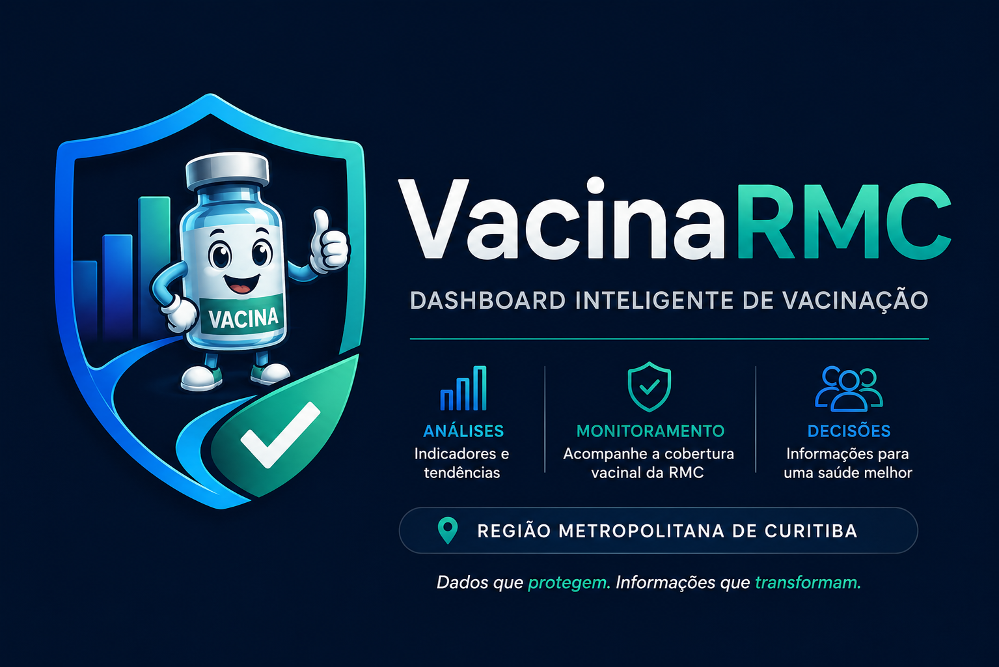
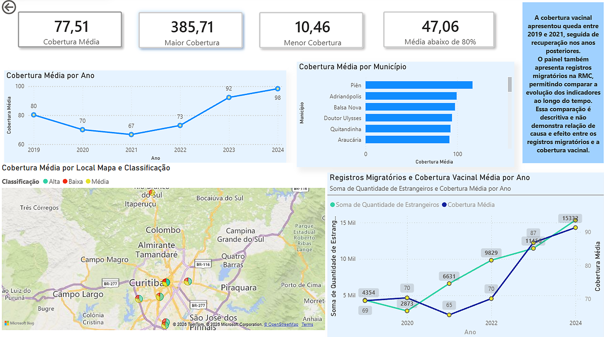
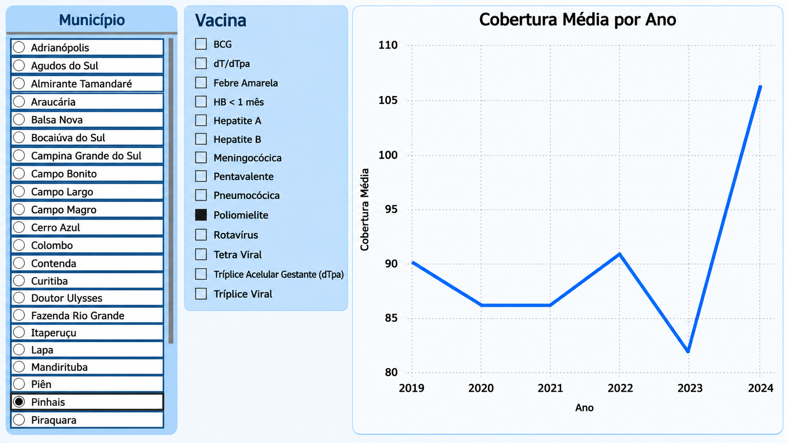

# 💉 BI Vacinas RMC

**Dashboard Analítico de Cobertura Vacinal da Região Metropolitana de Curitiba**

Projeto acadêmico desenvolvido no Curso Superior de Tecnologia em Gestão da Tecnologia da Informação (GTI), do Instituto Federal do Paraná (IFPR) – Campus Pinhais.

<p align="center">
  
</p>Dashboard – Página 1
<p align="center">
  
</p>Dashboard – Página 2
<p align="center">
  
</p>O site contém gráficos interativos, filtros por município, vacina e ano, além de uma tabela com os dados. Porém, não é ligado ao Power BI.


**Observação sobre a versão web:** existe uma versão demonstrativa local com gráficos e filtros interativos. Ela não está conectada diretamente ao Power BI e ainda não possui endereço público para acesso externo.

## 🔄 Fluxograma do Projeto Power Vacina RMC

<p align="center">
  
</p>O fluxograma apresenta as etapas do projeto, desde a utilização de bases públicas e o tratamento dos dados até a criação do dashboard no Power BI, o teste de usabilidade com sete profissionais da USF Vila Amélia e a divulgação do cartaz educativo sobre poliomielite, com 10 respostas ao formulário.
<p align="center">
  
</p><h1 align="center">VacinaRMC</h1><p align="center">
  <b>Dashboard Inteligente de Vacinação</b><br>
  Dados que protegem. Informações que transformam.
</p>📖 Sobre o Projeto
O VacinaRMC é um Dashboard Inteligente de Vacinação desenvolvido em Power BI, criado como Projeto Interdisciplinar do curso de Gestão da Tecnologia da Informação do Instituto Federal do Paraná (IFPR) – Campus Pinhais.

O dashboard analisa a evolução da cobertura vacinal dos municípios da Região Metropolitana de Curitiba (RMC) utilizando dados públicos do Ministério da Saúde e do IPARDES.

Além da cobertura vacinal, o projeto apresenta dados sobre a população estrangeira na região como informação demográfica complementar. Não foi realizada análise que demonstre relação causal entre a presença ou o crescimento da população estrangeira e as variações da cobertura vacinal.
🎯 Objetivos
- Monitorar a cobertura vacinal da Região Metropolitana de Curitiba;
- Comparar indicadores entre municípios;
- Visualizar a evolução da vacinação ao longo dos anos;
- Identificar municípios com cobertura crítica, conforme critério a ser documentado;
- Apresentar dados de vacinação e de população estrangeira como informações distintas e complementares;
- Apoiar gestores e profissionais da saúde na tomada de decisão.
🚀 Funcionalidades
📊 Indicadores
- Cobertura Vacinal Média
- Maior Cobertura
- Menor Cobertura
- Cobertura Crítica (critério de cálculo e classificação pendente de documentação)
- Classificação da Cobertura
📈 Visualizações
- Mapa Interativo da Região Metropolitana de Curitiba
- Evolução da Cobertura Vacinal
- Comparação entre Municípios
- Comparação por Vacina
- Indicadores (KPIs)
🔍 Filtros
- Município
- Vacina
- Ano
🛠 Tecnologias Utilizadas
- Power BI Desktop
- Power Query
- Microsoft Excel
- Figma
- GitHub
📂 Estrutura do Projeto

```text
Cobertura_Vacinal/
├── dashboard/
│   ├── BI_Vacinas_RMC_Atualizado.pbix
│   └── README.md
├── documentacao/
│   ├── Documentos do Projeto Interdisciplinar II
│   ├── Documentos do Projeto Interdisciplinar III
│   └── Arquivos de acompanhamento das sprints
├── imagens/
│   ├── logo_vacinaRMC.png
│   ├── dashboard_cobertura1.png
│   ├── dashboard_cobertura2.png
│   └── Fluxo do Projeto Power Vacina RMC.png
├── Artigo_Tecnico_Final.pdf
└── README.md
```


---

## 📑 Documentação

Toda a documentação do projeto BI Vacinas RMC encontra-se na pasta [documentacao](documentacao).

Os documentos registram a trajetória do projeto desde a ideação, o planejamento e o desenvolvimento até os testes de usabilidade, as ações de extensão e a entrega final.

### 💡 Projeto Interdisciplinar II — 2026/1

#### Gestão e Monitoramento do Projeto

- [Sprint 1 — Ideação e planejamento](documentacao/gestao_monitoramento_sprint1.md)
- [Sprint 2 — Pesquisa e levantamento de requisitos](documentacao/gestao_monitoramento_sprint2.md)
- [Sprint 3 — Prototipação e desenvolvimento](documentacao/gestao_monitoramento_sprint3.md)
- [Sprint 4 — Finalização e entrega](documentacao/gestao_monitoramento_sprint4.md)

### 🎓 Projeto Interdisciplinar III — 2026/2

- [Template do Projeto Interdisciplinar III](documentacao/TEMPLATE%20DE%20PROJETO%20III.pdf)
- [Relatório de teste de usabilidade e lições aprendidas](documentacao/RELAT%C3%93RIO%20DE%20TESTE%20DE%20USABILIDADE%20E%20LI%C3%87%C3%95ES%20APRENDIDAS.docx.pdf)


### 🤝 Projeto e Ações de Extensão

- [Projeto de Extensão — Documento original](documentacao/PROJETO%20DE%20EXTENS%C3%83O.docx%20%281%29.pdf)
- [Relato de experiência da ação de extensão](documentacao/RELATO%20DE%20EXPERI%C3%8ANCIA%20DE%20A%C3%87%C3%83O%20DE%20EXTENS%C3%83O.pdf)


### 🎥 Demonstração do Produto

- [Vídeo de Demonstração do Projeto](documentacao/Vídeo%20de%20Demonstração)

### 📄 Produção Acadêmica

- [Artigo Técnico Final — BI Vacinas RMC](Artigo_Tecnico_Final.pdf)

Os documentos apresentam o desenvolvimento do projeto, as decisões técnicas, as atividades realizadas, as ações de extensão e os resultados dos testes realizados na USF Vila Amélia.

---


## 📊 Fontes dos Dados

Os dados utilizados no projeto BI Vacinas RMC foram obtidos de bases públicas, incluindo:

- Ministério da Saúde;
- InfoMS;
- Instituto Paranaense de Desenvolvimento Econômico e Social (IPARDES);
- Dados Abertos do Paraná;
- Sistema de Registro Nacional Migratório (SISMIGRA).

**Dados de cobertura vacinal**

Foram utilizados dados de cobertura vacinal organizados por município, vacina e ano, com apoio do Excel, Power Query e Power BI.

Durante a verificação dos indicadores, também foi consultada a planilha `Imunizações_Tabela.xlsx`.

### 🌎 Dados migratórios — SISMIGRA

Os dados migratórios utilizados no projeto foram obtidos do **Sistema de Registro Nacional Migratório (SISMIGRA)**, disponibilizado pelo Ministério da Justiça e Segurança Pública, por meio do portal de microdados do Observatório das Migrações Internacionais (OBMigra).

A base é constituída por registros administrativos da Polícia Federal referentes a pessoas não nacionais com autorização de residência regular no Brasil.

Foram utilizados arquivos CSV referentes ao período de 2019 a 2024:

- `sismigra_2019_2020.csv`
- `sismigra_2021.csv`
- `sismigra_2022.csv`
- `sismigra_2023.csv`
- `sismigra_2024.csv`

Os dados foram utilizados como informação demográfica complementar à análise da cobertura vacinal na Região Metropolitana de Curitiba.

**Observação metodológica:** os registros do SISMIGRA não representam necessariamente o total de estrangeiros residentes em cada município. A comparação com a cobertura vacinal tem caráter descritivo e não demonstra relação de causa e efeito.

**Fonte:** Polícia Federal / Ministério da Justiça e Segurança Pública — OBMigra.

**Disponível em:** https://www.gov.br/mj/pt-br/assuntos/seus-direitos/migracoes/portal-de-imigracao-laboral/obmigra-1/microdados/sismigra/SISMIGRA


## ⚠️ Tratamento e interpretação de coberturas superiores a 100%

Durante a verificação dos indicadores do dashboard, foi identificado o valor de **385,71%**, referente ao município de **Piên**, à vacina **Tríplice Viral**, no ano de **2019**.

O valor foi localizado na tabela `Cobertura Vacinal` do Power BI e também na planilha `Imunizações_Tabela.xlsx`, consultada durante a verificação.

A medida DAX utilizada é:

```DAX
Maior Cobertura = MAX('Cobertura Vacinal'[Cobertura])
```

Essa medida retorna o maior valor da coluna no contexto dos filtros aplicados. Portanto, o percentual de 385,71% não foi produzido pela soma dos registros.

### Possíveis explicações

Coberturas superiores a 100% podem ocorrer quando o número de doses considerado no indicador supera a estimativa da população-alvo.

Também podem decorrer de diferenças metodológicas, inconsistências nos registros ou outros fatores.

**A causa específica do valor de 385,71% ainda não foi determinada**, sendo necessária a conferência da metodologia e dos dados da fonte pública original.

### Critérios de interpretação e tratamento

Para preservar a transparência e a rastreabilidade dos dados, o projeto adota os seguintes critérios:

1. **Preservar o valor original:** manter os registros conforme recebidos, inclusive quando a cobertura ultrapassa 100%.

2. **Sinalizar valores superiores a 100%:** esses registros devem receber um aviso de interpretação no dashboard.

3. **Não limitar automaticamente a 100%:** substituir valores superiores a 100% por 100% poderia ocultar problemas ou particularidades da fonte.

4. **Documentar a origem e a metodologia:** registrar os arquivos utilizados, as fontes públicas, as datas de acesso e os critérios de cálculo, quando confirmados.

**Situação da implementação:** a preservação do valor original foi verificada. A sinalização visual dos registros superiores a 100% ainda será implementada.

**Importante:** o valor de 385,71% não significa que 385,71% da população de Piên tenha sido vacinada.

---

## 📉 Critério do indicador "Média Abaixo de 80%"

O cartão anteriormente identificado como **Cobertura Crítica** foi renomeado, apenas na apresentação do visual, para **Média Abaixo de 80%**, de modo a explicitar o que a medida calcula.

O nome interno da medida DAX permanece `Cobertura Crítica`.

```DAX
Cobertura Crítica =
CALCULATE(
    AVERAGE('Cobertura Vacinal'[Cobertura]),
    'Cobertura Vacinal'[Cobertura] < 80
)
```

A medida calcula a média aritmética dos registros de cobertura inferiores a 80%, considerando o contexto dos filtros aplicados.

No relatório examinado, o cartão apresentou **47,06%**.

Esse número:

- Não representa o percentual de municípios com cobertura crítica;
- Não corresponde a uma meta oficial;
- Não é ponderado pelo tamanho da população de cada município.

O limite de 80% é um **critério analítico adotado no projeto**, e não uma meta universal do Ministério da Saúde.

As metas e os parâmetros de avaliação podem variar conforme a vacina e o público-alvo.


---

## 🌎 Interpretação dos dados sobre população estrangeira

O dashboard apresenta, para fins descritivos, a evolução da cobertura vacinal e dos registros migratórios na Região Metropolitana de Curitiba (RMC), entre 2019 e 2024.

Os dados migratórios são provenientes do Sistema de Registro Nacional Migratório (SISMIGRA), disponibilizado pelo Ministério da Justiça e Segurança Pública, por meio do portal OBMigra, tendo como fonte original a Polícia Federal.

A apresentação das duas séries em um mesmo gráfico permite observar tendências temporais, mas não comprova associação estatística nem relação de causa e efeito.

Os registros migratórios não representam necessariamente o total de estrangeiros residentes em cada município.

**Importante:** o projeto não atribui as alterações da cobertura vacinal ao aumento da população estrangeira.

A comparação possui caráter exclusivamente descritivo e complementar, contribuindo para a contextualização dos indicadores de saúde pública da RMC.

---

---

## 💡 Ideação e Evolução do Projeto

O projeto BI Vacinas RMC teve início em 5 de março de 2026, a partir da proposta de utilizar ferramentas de Business Intelligence para facilitar a análise dos indicadores de cobertura vacinal na Região Metropolitana de Curitiba.

A ideação envolveu pesquisas de bases públicas, consultas a profissionais de saúde, identificação de necessidades e definição do escopo do projeto.

O desenvolvimento foi organizado em quatro sprints, documentando o planejamento, as atividades realizadas, as dificuldades encontradas, as decisões técnicas e as lições aprendidas.

### 📅 Histórico das Sprints

| Sprint | Etapa | Período | Principais atividades |
|---|---|---|---|
| Sprint 1 | Ideação e planejamento | 05/03 a 22/03/2026 | Definição do tema, pesquisa de dados públicos e modelagem inicial. |
| Sprint 2 | Pesquisa e requisitos | 24/03 a 08/04/2026 | Capacitação em Power BI e definição dos indicadores. |
| Sprint 3 | Prototipação e desenvolvimento | 08/04 a 29/04/2026 | Protótipo no Figma, integração das bases e desenvolvimento do dashboard. |
| Sprint 4 | Finalização e entrega | 20/04 a 30/04/2026 | Revisão dos dados, KPIs, filtros, layout e documentação. |


### 📂 Documentos de Gestão e Monitoramento

- [Sprint 1 — Ideação e planejamento](documentacao/gestao_monitoramento_sprint1.md)
- [Sprint 2 — Pesquisa e levantamento de requisitos](documentacao/gestao_monitoramento_sprint2.md)
- [Sprint 3 — Prototipação e desenvolvimento](documentacao/gestao_monitoramento_sprint3.md)
- [Sprint 4 — Finalização e entrega](documentacao/gestao_monitoramento_sprint4.md)


### 📊 Indicadores de acompanhamento

- 4 sprints documentadas;
- 24 tarefas planejadas;
- 24 tarefas registradas como concluídas;
- Registros de Daily Scrum;
- Planejamento das sprints;
- Sprint Review e Sprint Retrospective;
- Registro de dificuldades e lições aprendidas.

### 🚀 Continuidade do Projeto — 2026/2

No Projeto Interdisciplinar III, o trabalho teve continuidade com o aprimoramento do dashboard, a avaliação de usabilidade com profissionais da USF Vila Amélia e a realização de uma ação de extensão voltada à comunicação dos indicadores de cobertura vacinal à comunidade.

O projeto integra tecnologia, análise de dados, saúde pública e responsabilidade social.

---

## 📌 Metodologia

O projeto foi desenvolvido utilizando:

- Design Thinking
- Scrum
- Product Backlog
- Daily Scrum
- Sprint Review
- Sprint Retrospective

## 🔄 Processos do Projeto — BI Vacinas RMC

O desenvolvimento do dashboard foi organizado em cinco etapas, desde a obtenção dos dados públicos até a avaliação com usuários.

| Etapa | Processo | Descrição |
|---|---|---|
| 1 | Coleta dos dados | Obtenção de bases públicas de cobertura vacinal, incluindo dados atribuídos ao Ministério da Saúde, IPARDES e Dados Abertos do Paraná. |
| 2 | Tratamento dos dados | Limpeza, padronização e organização dos registros no Power Query, incluindo a estruturação por município, vacina, ano e valor. |
| 3 | Modelagem | Estruturação dos dados no Power BI para relacionar informações e permitir consultas por município, vacina e ano. |
| 4 | Construção do dashboard | Desenvolvimento de gráficos, indicadores e filtros interativos para facilitar a interpretação dos dados. |
| 5 | Validação com usuários | Teste de usabilidade com sete profissionais da USF Vila Amélia, com média de 93,21/100 na escala SUS. |

### 🛠️ Ferramentas utilizadas

- **Power BI:** visualização e análise dos dados.
- **Excel:** apoio à organização dos dados.
- **Power Query:** tratamento e transformação dos dados.

### 📊 Principais funcionalidades

- Filtros por município, vacina e ano;
- Indicadores de cobertura vacinal;
- Comparação entre municípios da Região Metropolitana de Curitiba;
- Gráficos interativos.

### ✅ Resultado

Dashboard desenvolvido e avaliado inicialmente com usuários reais.

Os resultados do teste representam uma avaliação inicial de usabilidade e não constituem validação generalizável para todas as unidades de saúde.

---

## 📈 Dashboard

### 📥 Arquivo do Dashboard Power BI

O arquivo do projeto está disponível para consulta e download no repositório.

**[Baixar o Dashboard BI Vacinas RMC (.pbix)](dashboard/BI_Vacinas_RMC_Atualizado.pbix)**

Para visualizar os gráficos, indicadores, mapas e filtros interativos, é necessário abrir o arquivo no Power BI Desktop.
---

**Observação:** o arquivo disponibilizado corresponde ao projeto desenvolvido no Power BI. O GitHub armazena o arquivo, mas não executa o dashboard diretamente no navegador.
O dashboard permite:
- Visualizar a evolução da cobertura vacinal;
- Comparar indicadores entre municípios;
- Filtrar por vacina e período;
- Identificar municípios com cobertura abaixo da meta, conforme os critérios definidos para cada indicador;
- Consultar dados sobre população estrangeira na RMC como informação demográfica complementar, sem atribuir causalidade à cobertura vacinal.
## 🎓 Projeto Acadêmico

Projeto desenvolvido como requisito da disciplina Projeto Interdisciplinar II, do Curso Superior de Tecnologia em Gestão da Tecnologia da Informação do Instituto Federal do Paraná (IFPR) – Campus Pinhais.

---

## 🎓 Continuidade no Projeto Interdisciplinar III – 2026/2

No 6º período de Gestão da Tecnologia da Informação, o Power Vacina RMC teve continuidade com ações de extensão, avaliação da usabilidade do dashboard e elaboração de uma proposta de modelo de negócio.

As atividades aproximaram a análise de dados da rotina dos profissionais de saúde e da comunidade de Pinhais.

### 🧪 Teste de usabilidade na USF Vila Amélia

Nos dias 15 e 16 de outubro de 2026, o dashboard foi avaliado por 7 profissionais vinculados à Unidade de Saúde da Família Vila Amélia, em Pinhais/PR.

Cada participante realizou quatro tarefas no Power BI, envolvendo consulta de indicadores, seleção de município, seleção da vacina poliomielite e interpretação de informações.

| Indicador | Resultado |
|---|---|
| Participantes | 7 profissionais |
| Tarefas propostas | 4 por participante |
| Tarefas concluídas sem ajuda | 28 de 28 |
| Média do questionário SUS | 93,21 pontos em 100 |


O resultado foi favorável entre os participantes. Também foram identificadas sugestões para melhorar a visibilidade dos filtros, diferenciar as vacinas nos gráficos e estudar uma organização por faixa etária.

Como a avaliação envolveu um grupo pequeno de uma única unidade, seus resultados não representam todos os possíveis usuários.

---

### 📢 Ação de extensão: cartaz educativo sobre poliomielite

Foi elaborado um cartaz com dados de cobertura vacinal contra a poliomielite entre 2019 e 2024, referentes a Adrianópolis, Colombo, Curitiba e Pinhais.

O material foi exposto na USF Vila Amélia e divulgado pelo Status do WhatsApp. Um QR Code direcionou os interessados a um formulário de avaliação.

O formulário recebeu **10 respostas**. Nas três perguntas sobre facilidade de compreensão, contribuição para entender os dados e importância da divulgação, todas as respostas foram **“Sim”**.

Esses resultados registram a percepção dos respondentes, mas não comprovam aprendizagem nem representam toda a comunidade.

---

### 💼 Proposta de modelo de negócio

Como exercício acadêmico, foi elaborada uma possibilidade futura de prestação de serviços para Secretarias Municipais de Saúde da RMC, com implantação e personalização do dashboard, treinamento e manutenção.

| Serviço | Valor hipotético |
|---|---|
| Implantação e personalização por secretaria | R$ 8.000,00 |
| Manutenção e suporte mensal | R$ 500,00 |
| Faturamento bruto no primeiro ano por secretaria (12 meses) | R$ 14.000,00 |


**Importante:** esses valores são simulações para o plano de negócio. O projeto ainda não foi comercializado. Custos, licenças, tributos e condições de contratação pública precisariam ser avaliados antes de uma oferta real.

---

### 🏛️ Implantação proposta nas Secretarias de Saúde

A implantação do BI Vacinas RMC seguiria as seguintes etapas:

1. Levantamento das necessidades da secretaria;
2. Personalização do dashboard;
3. Implantação e disponibilização do acesso;
4. Treinamento dos profissionais;
5. Suporte técnico.

O modelo prevê a adaptação do painel às necessidades de cada secretaria, considerando a infraestrutura disponível e as licenças necessárias. A contratação por órgãos públicos dependerá das regras aplicáveis.

---

### 📊 Simulação financeira apresentada na WIPEX

Além do cenário hipotético de R$ 8.000,00 por implantação e R$ 500,00 mensais de manutenção, o infográfico de viabilidade financeira da apresentação WIPEX utiliza um cenário acadêmico alternativo, com preço de **R$ 3.500,00 por implantação**.

Os dois cenários não devem ser somados nem tratados como preços comerciais já validados.

#### Investimento estimado no primeiro ano

| Descrição | Cálculo | Valor |
|---|---|---|
| Desenvolvimento | 60 horas × R$ 80,00 | R$ 4.800,00 |
| Licença Power BI Pro (hipótese do slide) | 12 meses × R$ 80,20 | R$ 962,40 |
| Suporte técnico | 24 horas × R$ 80,00 | R$ 1.920,00 |
| **Total estimado** | | **R$ 7.682,40** |

#### Projeção hipotética de faturamento

| Ano | Implantações hipotéticas | Faturamento bruto projetado |
|---|---|---|
| 1º ano | 2 | R$ 7.000,00 |
| 2º ano | 3 | R$ 10.500,00 |
| 3º ano | 4 | R$ 14.000,00 |
| **Total em três anos** | **9** | **R$ 31.500,00** |

#### Resultado financeiro estimado

No primeiro ano, a diferença entre R$ 7.000,00 de faturamento e R$ 7.682,40 de custos estimados seria de **–R$ 682,40**.

Com três implantações, o faturamento hipotético de R$ 10.500,00 superaria esse orçamento em R$ 2.817,60, desde que não houvesse custos adicionais por implantação.

Isso não constitui cálculo definitivo de lucro ou ponto de equilíbrio econômico, pois ainda faltam custos variáveis, impostos e validação comercial.

---
### 🏢 Concorrência potencial

Os possíveis concorrentes do BI Vacinas RMC incluem:

- Consultorias especializadas em Business Intelligence (BI);
- Empresas de tecnologia que prestam serviços ao setor público;
- Profissionais autônomos que desenvolvem dashboards;
- Equipes internas de tecnologia das prefeituras.

### ✅ Diferenciais do BI Vacinas RMC

O projeto apresenta os seguintes diferenciais:

- Foco na análise da cobertura vacinal da Região Metropolitana de Curitiba;
- Dashboard já desenvolvido no Power BI;
- Teste inicial de usabilidade realizado com sete profissionais da USF Vila Amélia;
- Média de **93,21 pontos na escala SUS**;
- Possibilidade de personalização para diferentes municípios;
- Proposta de treinamento e suporte técnico.

### ⚠️ Limitações e perspectivas futuras

O BI Vacinas RMC é um projeto acadêmico que apresenta potencial para aplicação em Secretarias Municipais de Saúde.

Entretanto, ainda são necessárias avaliações complementares sobre:

- Demanda real pelo serviço;
- Custos de implantação e manutenção;
- Licenciamento do Power BI;
- Preços praticados no mercado;
- Viabilidade comercial e contratação pública.

**O projeto ainda não registra vendas realizadas.** As projeções financeiras apresentadas são simulações acadêmicas e não representam resultados comerciais efetivos.
---

### 👩‍💻 Autora

Katia Dhaem

Curso Superior de Tecnologia em Gestão da Tecnologia da Informação

Instituto Federal do Paraná – Campus Pinhais

<p align="center">
  <b>VacinaRMC</b><br>
  Dashboard Inteligente de Vacinação<br><br>
  Dados que protegem. Informações que transformam.
</p>
