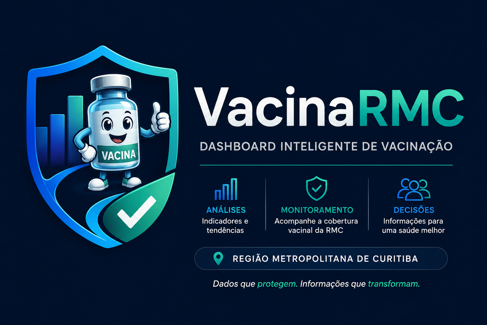
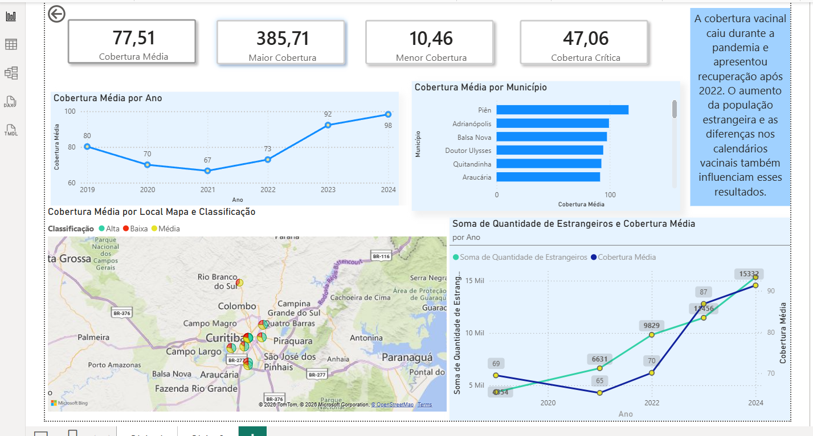
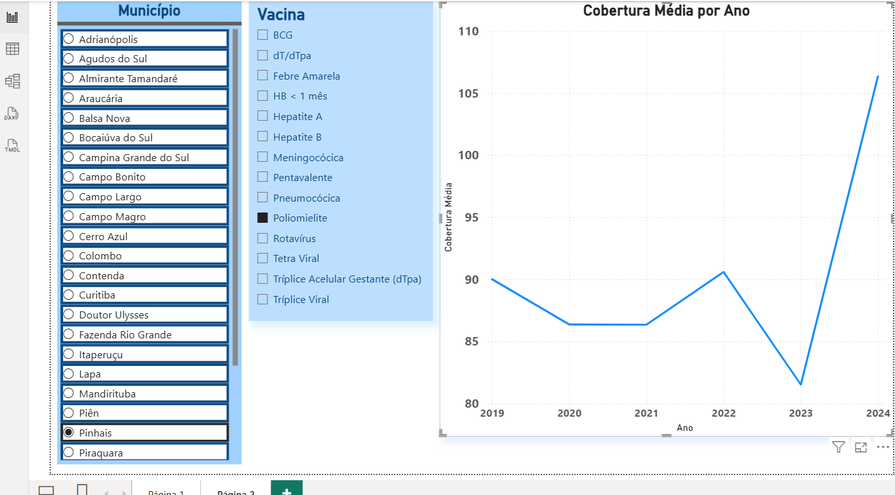

Dashboard Analítico de Cobertura Vacinal da Região Metropolitana de Curitiba

  

Dashboard – Página 1

  

Dashboard – Página 2

  
  ## Fluxograma do Projeto Power Vacina RMC

imagens/Fluxo do Projeto Power Vacina RMC.png
Fluxograma do Projeto Power Vacina RMC

  

O fluxograma apresenta as etapas do projeto, desde a utilização de bases públicas e o tratamento dos dados até a criação do dashboard no Power BI, o teste de usabilidade e a divulgação do cartaz educativo à comunidade.

  

<h1 align="center">VacinaRMC</h1>

<b>Dashboard Inteligente de Vacinação</b> 
Dados que protegem. Informações que transformam.

📖 Sobre o Projeto
O VacinaRMC é um Dashboard Inteligente de Vacinação desenvolvido em Power BI, criado como Projeto Interdisciplinar do curso de Gestão da Tecnologia da Informação do Instituto Federal do Paraná (IFPR) – Campus Pinhais.

O dashboard analisa a evolução da cobertura vacinal dos municípios da Região Metropolitana de Curitiba (RMC) utilizando dados públicos do Ministério da Saúde e do IPARDES.

Além da cobertura vacinal, o projeto integra dados sobre a entrada de estrangeiros na região, permitindo análises complementares sobre possíveis fatores relacionados à variação dos índices de vacinação entre os anos de 2019 e 2024.
🎯 Objetivos
- Monitorar a cobertura vacinal da Região Metropolitana de Curitiba;
- Comparar indicadores entre municípios;
- Visualizar a evolução da vacinação ao longo dos anos;
- Identificar municípios com cobertura crítica;
- Integrar dados de vacinação e estrangeiros;
- Apoiar gestores e profissionais da saúde na tomada de decisão.
🚀 Funcionalidades
📊 Indicadores
- Cobertura Vacinal Média
- Maior Cobertura
- Menor Cobertura
- Cobertura Crítica
- Classificação da Cobertura
📈 Visualizações
- Mapa Interativo da Região Metropolitana de Curitiba
- Evolução da Cobertura Vacinal
- Comparação entre Municípios
- Comparação por Vacina
- Indicadores (KPIs)
🔍 Filtros
- Município
- Vacina
- Ano
🛠 Tecnologias Utilizadas
- Power BI Desktop
- Power Query
- Microsoft Excel
- Figma
- GitHub
📂 Estrutura do Projeto
Cobertura_Vacinal
│
├── dashboard/
│   └── Dashboard.pbix
│
├── dados/
│
├── documentacao/
│   ├── Projeto_Interdisciplinar_II.pdf
│   ├── gestao_monitoramento_sprint1.md
│   ├── gestao_monitoramento_sprint2.md
│   ├── gestao_monitoramento_sprint3.md
│   ├── gestao_monitoramento_sprint4.md
│   ├── Relatorio_Desempenho_Sprint4.md
│   ├── Template_Projeto_III.pdf             (enviar)
│   ├── Relato_Extensao.pdf                  (enviar)
│   └── Relatorio_Usabilidade.pdf            (enviar)
│
├── imagens/
│   ├── logo_vacinaRMC.png
│   ├── dashboard_cobertura1.png
│   ├── dashboard_cobertura2.png
│   └── fluxo_power_vacina_rmc.png
│
└── README.md
📑 Documentação
Toda a documentação do projeto encontra-se na pasta documentacao.
- Sprint 1
- Sprint 2
- Sprint 3
- Sprint 4
- Relatório de Desempenho
- Projeto Interdisciplinar II
<!-- ACRÉSCIMO: DOCUMENTAÇÃO DO PROJETO III -->
Documentos do Projeto Interdisciplinar III (2026/2):
- [Template do Projeto Interdisciplinar III](documentacao/Template_Projeto_III.pdf)
- [Relato de experiência da ação de extensão](documentacao/Relato_Extensao.pdf)
- [Relatório de teste de usabilidade e lições aprendidas](documentacao/Relatorio_Usabilidade.pdf)
Os três links acima funcionarão depois que os PDFs forem enviados à pasta documentacao com esses nomes.
📊 Fontes dos Dados
Os dados utilizados são provenientes de bases públicas:
- Ministério da Saúde
- InfoMS
- IPARDES
- Dados Abertos do Paraná
📌 Metodologia
O projeto foi desenvolvido utilizando:
- Design Thinking
- Scrum
- Product Backlog
- Daily Scrum
- Sprint Review
- Sprint Retrospective
📈 Dashboard
O dashboard permite:
- Visualizar a evolução da cobertura vacinal;
- Comparar indicadores entre municípios;
- Filtrar por vacina e período;
- Identificar municípios com cobertura abaixo da meta;
- Analisar dados relacionados à população estrangeira na RMC.
🎓 Projeto Acadêmico
Projeto desenvolvido como requisito da disciplina Projeto Interdisciplinar II, do Curso Superior de Tecnologia em Gestão da Tecnologia da Informação do Instituto Federal do Paraná (IFPR) – Campus Pinhais.
<!-- ACRÉSCIMO: PROJETO INTERDISCIPLINAR III -->
🎓 Continuidade no Projeto Interdisciplinar III – 2026/2
No 6º período de Gestão da Tecnologia da Informação, o Power Vacina RMC teve continuidade com ações de extensão, avaliação da usabilidade do dashboard e elaboração de uma proposta de modelo de negócio. As atividades aproximaram a análise de dados da rotina dos profissionais de saúde e da comunidade de Pinhais.
🧪 Teste de usabilidade na USF Vila Amélia
Nos dias 15 e 16 de outubro de 2026, o dashboard foi avaliado por 7 profissionais vinculados à Unidade de Saúde da Família Vila Amélia, em Pinhais/PR. Cada participante realizou quatro tarefas no Power BI, envolvendo consulta de indicadores, seleção de município, seleção da vacina poliomielite e interpretação de informações.
Indicador	Resultado
Participantes	7 profissionais
Tarefas propostas	4 por participante
Tarefas concluídas sem ajuda	28 de 28
Média do questionário SUS	93,21 pontos em 100

O resultado foi favorável entre os participantes. Também foram identificadas sugestões para melhorar a visibilidade dos filtros, diferenciar as vacinas nos gráficos e estudar uma organização por faixa etária. Como a avaliação envolveu um grupo pequeno de uma única unidade, seus resultados não representam todos os possíveis usuários.
📢 Ação de extensão: cartaz educativo sobre poliomielite
Foi elaborado um cartaz com dados de cobertura vacinal contra a poliomielite entre 2019 e 2024, referentes a Adrianópolis, Colombo, Curitiba e Pinhais. O material foi exposto na USF Vila Amélia e divulgado pelo Status do WhatsApp. Um QR Code direcionou os interessados a um formulário de avaliação.

O formulário recebeu 10 respostas. Nas três perguntas sobre facilidade de compreensão, contribuição para entender os dados e importância da divulgação, todas as respostas foram “Sim”. Esses resultados registram a percepção dos respondentes, mas não comprovam aprendizagem nem representam toda a comunidade.
💼 Proposta de modelo de negócio
Como exercício acadêmico, foi elaborada uma possibilidade futura de prestação de serviços para Secretarias Municipais de Saúde da RMC, com implantação e personalização do dashboard, treinamento e manutenção.
Serviço	Valor hipotético
Implantação e personalização por secretaria	R$ 8.000,00
Manutenção e suporte mensal	R$ 500,00
Faturamento bruto no primeiro ano por secretaria (12 meses)	R$ 14.000,00

Importante: esses valores são simulações para o plano de negócio. O projeto ainda não foi comercializado. Custos, licenças, tributos e condições de contratação pública precisariam ser avaliados antes de uma oferta real.
👩‍💻 Autora
Katia Dhaem

Curso Superior de Tecnologia em Gestão da Tecnologia da Informação

Instituto Federal do Paraná – Campus Pinhais

VacinaRMC
Dashboard Inteligente de Vacinação

Dados que protegem. Informações que transformam.

